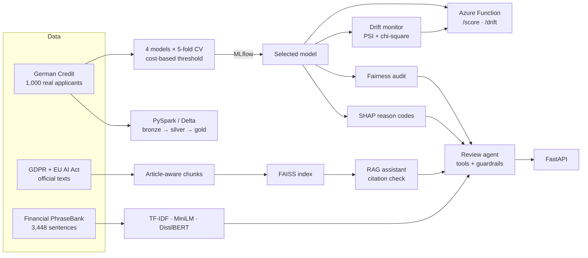

<div align="center">

# ⚖️ Nyaya

### Fair, explainable credit decisions, grounded in the law

*Nyaya (न्याय) is Sanskrit for justice and sound reasoning.*

[](https://github.com/shubhamyad86-ai/nyaya/actions/workflows/ci.yml)


</div>

---

## Why this project exists

When a bank lets an algorithm decide who gets a loan, three questions matter as much as accuracy:

1. **Is it fair?** Does the model treat young people, women or foreign workers worse than it should?
2. **Can it explain itself?** GDPR Article 22 gives people the right not to be judged by a machine
   alone, and the EU AI Act lists credit scoring as **high-risk AI** (Annex III).
3. **Does it still work tomorrow?** Customers change, and a model trained on yesterday's applicants
   can quietly go wrong.

**Nyaya answers all three in one working system**, built on real data: a credit-risk model that is
chosen by business cost, explained with SHAP, audited for fairness and monitored for drift, plus an
AI assistant and agent that look up the actual law and are not allowed to invent citations.

---

## At a glance

| | |
|---|---|
| 🏦 **Credit risk** | 4 models compared with 5-fold cross-validation; the threshold is set by **business cost** (a missed defaulter costs 5× a lost customer), not by accuracy |
| 🔍 **Explainability** | SHAP **reason codes** for every applicant ("loan duration raised the risk the most") |
| ⚖️ **Fairness audit** | Approval rates by age, sex and foreign-worker status, four-fifths rule, equal opportunity; protected attributes are **never** model inputs |
| 📜 **Law assistant (RAG)** | Answers questions from the **official GDPR and EU AI Act texts** (212 articles, 353 recitals, 13 annexes) and checks every citation it gives |
| 🤖 **Review agent** | An LLM agent chooses its own tools (score, search the law, fairness check, sentiment); **code, not the model, decides when a human must review** |
| 📈 **Drift monitoring** | Population Stability Index **plus a significance test**, so small batches don't raise false alarms |
| 📰 **Financial NLP** | Sentiment on 3,448 expert-labelled news sentences: TF-IDF vs MiniLM embeddings vs **DistilBERT fine-tuned in PyTorch** |
| ☁️ **Production path** | FastAPI service, **Azure Functions** deployment kit, **Databricks** notebook with Delta tables, Docker, 41 tests and GitHub Actions CI |

---

## How it fits together



---

## Results

Every number below is produced by the code in this repository and written here automatically by
`python scripts/update_docs.py`, so the README always matches the last training run.

### 🏦 Credit risk and fairness

<!-- auto:credit -->
**Credit model: XGBoost** (held-out test set, 200 applicants)

| Metric | Value |
|---|---|
| ROC AUC | 0.791 (CV 0.794 ± 0.028) |
| Defaulters caught | 87% (52 of 60) |
| Expected cost per applicant | 0.555 vs 0.70 reject-all and 1.50 approve-all |

**Fairness:** age, sex and foreign-worker status are not model inputs. Sex passes the four-fifths rule (0.86). Age fails (0.46, out-of-fold): under-25s are approved 20% of the time versus 44% for older applicants. A controlled experiment shows that removing age as an input barely changes this (disparate impact 0.45 with it, 0.46 without) and does not reach 0.80, because proxies such as housing and employment length carry the signal, so the model card recommends a dedicated mitigation step. See [docs/MODEL_CARD.md](docs/MODEL_CARD.md).
<!-- /auto:credit -->


### 📜 Finding the right law

<!-- auto:rag -->
**RAG retrieval** (37 hand-labelled questions: 25 GDPR, 12 EU AI Act; offline TF-IDF embeddings)

| Search | hit@1 | hit@4 | primary article in top 4 | MRR@10 |
|---|---|---|---|---|
| Both laws together | 0.54 | 0.81 | 0.76 | 0.67 |
| Filtered to the right law | 0.57 | 0.89 | 0.84 | 0.72 |

The two laws use similar language, so searching both makes GDPR questions harder (hit@4 0.76); filtering by regulation recovers it (0.88). These are baseline numbers from the offline index; `python scripts/compare_retrieval.py` measures the semantic `all-MiniLM-L6-v2` index on the same questions.
<!-- /auto:rag -->

### 📈 Drift monitoring

<!-- auto:drift -->
| Batch | Result |
|---|---|
| Held-out test set (same population) | OK |
| Applicants under 25 (new segment) | ALERT: housing and employment duration; mean P(default) 0.39 → 0.49 |
| Largest 25% of loans (product change) | ALERT: amount, amount per month, duration and purpose; mean P(default) 0.39 → 0.50 |
<!-- /auto:drift -->

PSI alone flagged 70–100% of random 30–60 applicant samples of the *training data itself* as drifted.
Adding a chi-square test (Bonferroni-corrected) cut those false alerts to 0–2% while still catching the
real shifts above.

### 📰 Financial sentiment (690 held-out sentences, 3 classes)

<!-- auto:sentiment -->
| Method | Accuracy | Macro-F1 | F1 negative | F1 neutral | F1 positive |
|---|---|---|---|---|---|
| TF-IDF + logistic regression | 0.864 | **0.821** | 0.767 | 0.909 | 0.787 |
| Frozen MiniLM embeddings + logistic regression | not run yet - see notebooks/financial_sentiment_colab.ipynb | | | | |
| DistilBERT fine-tuned (PyTorch) | not run yet - see notebooks/financial_sentiment_colab.ipynb | | | | |
<!-- /auto:sentiment -->

Macro-F1 is the headline metric because 62% of sentences are neutral. The transformer rows come from
[notebooks/financial_sentiment_colab.ipynb](notebooks/financial_sentiment_colab.ipynb) on a free GPU.

---

## What I learned (the honest findings)

- **Removing a sensitive feature does not remove bias.** Age is not a model input, yet under-25s are
  still approved far less often. Housing and employment length act as proxies, and the drift monitor
  points at exactly those features for young applicants. Real mitigation needs a dedicated step
  (reweighing or group-aware thresholds) plus a legal review.
- **The industry-standard drift metric over-reacts.** PSI on small batches flagged random noise as
  drift most of the time. A significance test fixed it.
- **Small LLMs are bad at tool calling.** Instead of failing, the agent falls back to a fixed,
  auditable plan, and every citation is checked against what was actually retrieved.
- **The four credit models are within noise of each other.** Which one wins can change with library
  versions, so the documentation is generated from the results rather than typed by hand.
- **No FinBERT benchmark, on purpose.** FinBERT was trained on the same PhraseBank data, so testing it
  here would leak training data into the score.

---

## Try it

### Windows (easiest)

1. Double-click **`setup.bat`**. It installs everything, trains the models and runs the tests.
2. Double-click **`start_api.bat`**. The browser opens the interactive API at `http://127.0.0.1:8000/docs`.

Step-by-step help and troubleshooting: [RUN_GUIDE.md](RUN_GUIDE.md).

### Any platform

```bash
python -m venv .venv && source .venv/bin/activate      # Windows: .venv\Scripts\activate
pip install -r requirements-dev.txt -r requirements-nlp.txt
pip install -e .

python scripts/download_data.py                        # German Credit, GDPR, EU AI Act
python -m compliance_ai.credit.train                   # compare, explain, audit, log to MLflow
python -m compliance_ai.rag.build_index --backend tfidf
python -m compliance_ai.rag.evaluate
python -m compliance_ai.nlp.train --method tfidf_baseline
python scripts/drift_demo.py
python scripts/update_docs.py                          # write the results into this README
pytest -q

uvicorn compliance_ai.api:app --reload                 # http://127.0.0.1:8000/docs
```

For AI-written answers, install [Ollama](https://ollama.com) and run `ollama pull llama3.2:3b`, or set
`LLM_PROVIDER=azure` in `.env` (see `.env.example`) for Azure OpenAI. Without an LLM, the assistant
still returns the cited passages of the law.

### API

| Endpoint | What you get |
|---|---|
| `POST /credit/score` | Probability of default, decision and the top 4 reasons |
| `POST /credit/review` | Score + relevant law + reviewer memo; flags cases that need a human |
| `POST /agent/review` | The agent's review, the full tool trace and a citation check |
| `POST /compliance/ask` | An answer from GDPR / the EU AI Act with checked citations (optional `regulation` filter) |
| `POST /nlp/sentiment` | Positive / neutral / negative for financial news sentences |
| `POST /monitor/drift` | 30+ applicants → which features have shifted, and how much |
| `GET /health` | Which models and indexes are loaded |

### Cloud

- **Azure Functions:** `build_azure.bat` packages the model with pinned library versions;
  `deploy_azure.sh` in Azure Cloud Shell creates and tests `/api/health`, `/api/score` and `/api/drift`.
  → [docs/AZURE_DEPLOY.md](docs/AZURE_DEPLOY.md)
- **Databricks:** an importable notebook builds Unity Catalog Delta tables, trains with MLflow and
  audits fairness. → [docs/DATABRICKS.md](docs/DATABRICKS.md)
- **Docker:** `docker build -t nyaya . && docker run -p 8000:8000 nyaya`

---

## Design decisions

| Decision | Why |
|---|---|
| **Cost, not accuracy, picks the model** | Approving a defaulter costs 5× more than rejecting a good customer (Statlog cost matrix). Thresholds are tuned on out-of-fold predictions; the test set is touched once. |
| **The agent proposes, policy decides** | Whether a case needs human review is set in code from the score (GDPR Art. 22), never by the LLM. Unknown tools are refused and steps are capped. |
| **Chunks follow the law's structure** | One chunk per article, recital or annex, so every passage carries a precise citation like `GDPR Article 22`. |
| **Grounding is checked, not assumed** | Every citation in an answer is compared with what was retrieved; invented ones are flagged. |
| **Drift needs significance, not just size** | A shift is flagged only if PSI is large *and* the chi-square p-value is below 0.01 / number of features. |
| **Deployment pins what training used** | The Azure build reads the installed library versions so the saved model loads exactly as trained. |
| **Graceful degradation** | No LLM → cited passages only. Small LLM can't use tools → fixed plan. No Maven → Spark writes Parquet. |

---

## Project structure

```
src/compliance_ai/
  credit/      data · models · metrics (cost, threshold) · train (CV, MLflow)
               explain (SHAP) · fairness · segment (k-means, Isolation Forest) · predict
  rag/         ingest (article-aware chunks) · store (FAISS) · llm (Ollama / Azure)
               assistant (grounded answers) · evaluate
  nlp/         data · models (TF-IDF, embeddings, PyTorch fine-tuning) · train · predict
  agent.py     tool-calling review agent with guardrails
  monitoring.py  PSI + chi-square drift checks
  api.py       FastAPI service
notebooks/     Colab GPU run (sentiment) · Databricks pipeline
spark/         bronze → silver (+ quarantine) → gold with Delta Lake
deploy/        Azure Functions app, build and Cloud Shell deploy scripts
scripts/       download_data · eda · drift_demo · compare_retrieval · update_docs
eval/          37 hand-labelled questions for retrieval evaluation
reports/       metrics, plots, drift report
docs/          model card · Azure guide · Databricks guide
tests/         41 tests (unit, API, agent, Spark, Azure handlers)
```

Full model documentation, including limitations: [docs/MODEL_CARD.md](docs/MODEL_CARD.md).

---

## Data

| Dataset | Source | Use |
|---|---|---|
| Statlog German Credit (1,000 applicants) | UCI, H. Hofmann (1994), decoded CSV via [selva86/datasets](https://github.com/selva86/datasets) | Credit model, fairness, drift |
| GDPR, Regulation (EU) 2016/679 | Official EUR-Lex text via [coolharsh55/GDPRtEXT](https://github.com/coolharsh55/GDPRtEXT) | RAG assistant |
| EU AI Act, Regulation (EU) 2024/1689 | Official Journal HTML via [jsiddamsetty/aiactbrowser](https://github.com/jsiddamsetty/aiactbrowser) (pinned) | RAG assistant |
| Financial PhraseBank v1.0 | Malo et al. (2014), CC BY-NC-SA 3.0 ([details](data/finance_text/README.md)) | Sentiment NLP |

## Limitations

The credit data is small, old and from one country, so this demonstrates **method**, not a
production lending model. Retrieval is evaluated on 37 questions; LLM answers still need human review,
and nothing here is legal advice. The Databricks notebook was checked locally with PySpark rather
than on a Databricks workspace.

---

<div align="center">

**Shubham Yadav** · Data Scientist

[LinkedIn](https://www.linkedin.com/in/shubham-yadav-a69413200/) · [GitHub](https://github.com/shubhamyad86-ai)

</div>
