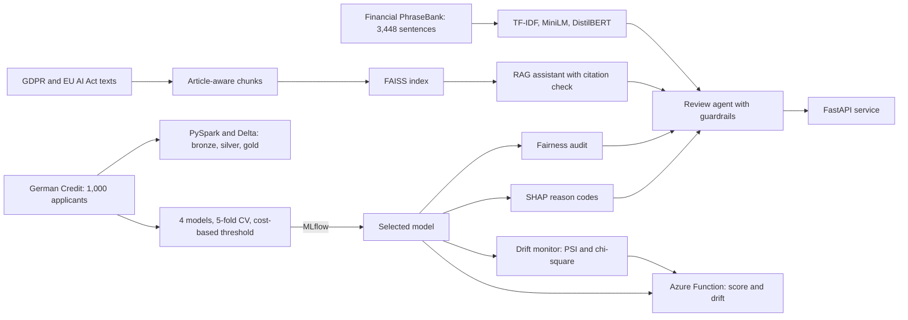

<div align="center">

# ⚖️ Nyaya

**Fair, explainable credit decisions, grounded in the law**

*Nyaya (न्याय) is Sanskrit for justice and sound reasoning.*

[](https://github.com/shubhamyad86-ai/nyaya/actions/workflows/ci.yml)


</div>

## Key results

<!-- auto:highlights -->
| **0.79** | **83%** | **0.933** | **89%** |
|---|---|---|---|
| credit ROC AUC (XGBoost) | of defaulters caught | DistilBERT macro-F1 | right law article in top 4 |
<!-- /auto:highlights -->

## Why I built this

When a bank lets an algorithm decide who gets a loan, accuracy is only part of the job. Three other
questions matter just as much:

- **Is it fair?** Does the model treat young people, women or foreign workers worse than it should?
- **Can it explain itself?** Under GDPR Article 22, people have the right not to be judged by a machine
  alone, and the EU AI Act lists credit scoring as high-risk AI (Annex III).
- **Will it still work next month?** Applicants change, and a model trained on last year's customers
  can go wrong without anyone noticing.

I wanted to build one system that takes all three seriously, on real data, and is honest about where it
falls short. Nyaya scores loan applications, explains every decision, audits the results for bias,
watches for drift, and looks up the actual law when a case needs review.

## What's inside

| Part | What it does |
|---|---|
| **Credit-risk model** | Compares four models with 5-fold cross-validation and picks the one with the lowest *business cost*, since approving a defaulter costs five times more than turning away a good customer. |
| **Explanations** | Uses SHAP to give every applicant their top reasons, for example "the loan duration raised the risk the most". |
| **Fairness audit** | Measures approval rates by age, sex and foreign-worker status with the four-fifths rule and equal opportunity. These attributes are never used as model inputs. |
| **Law assistant (RAG)** | Answers questions from the official GDPR and EU AI Act texts (212 articles, 353 recitals, 13 annexes) and checks every citation it gives against what it actually retrieved. |
| **Review agent** | An LLM agent that decides which tools to use: scoring, legal search, the fairness check or sentiment. Whether a human must review a case is decided in code, never by the model. |
| **Drift monitoring** | Compares new applicants with the training data using the Population Stability Index plus a significance test, so small batches don't raise false alarms. |
| **Financial sentiment** | Classifies 3,448 expert-labelled news sentences, comparing TF-IDF, frozen MiniLM embeddings and DistilBERT fine-tuned in PyTorch. |
| **A/B testing** | A champion-vs-challenger experiment for the credit model: power analysis, hash-based random assignment, a sample-ratio check, significance tests with confidence intervals, and a paired comparison on the same applicants. |
| **Batch checks** | Scores a CSV of new applicants in one go, flags every decision that needs a human under GDPR Article 22, and audits the batch for fairness and drift. |
| **Engineering** | FastAPI service, 47 tests with GitHub Actions CI, MLflow tracking, a Databricks pipeline with Delta tables, Docker and an Azure Functions deployment kit. |

## How it fits together



## Results

All numbers below come from the code in this repository. `python scripts/update_docs.py` writes them
into this README after each training run, so the text always matches the latest results.

### Credit risk and fairness

<!-- auto:credit -->
**Credit model: XGBoost** (held-out test set, 200 applicants)

| Metric | Value |
|---|---|
| ROC AUC | 0.791 (CV 0.795 ± 0.031) |
| Defaulters caught | 83% (50 of 60) |
| Expected cost per applicant | 0.645 vs 0.70 reject-all and 1.50 approve-all |

**Fairness:** age, sex and foreign-worker status are not model inputs. Sex passes the four-fifths rule (0.84). Age fails (0.48, out-of-fold): under-25s are approved 19% of the time versus 40% for older applicants. A controlled experiment shows that removing age as an input helps only partly (disparate impact 0.42 with it, 0.48 without) and does not reach 0.80, because proxies such as housing and employment length carry the signal, so the model card recommends a dedicated mitigation step. See [docs/MODEL_CARD.md](docs/MODEL_CARD.md).
<!-- /auto:credit -->


### Finding the right law

<!-- auto:rag -->
**RAG retrieval** (37 hand-labelled questions: 25 GDPR, 12 EU AI Act; offline TF-IDF embeddings)

| Search | hit@1 | hit@4 | primary article in top 4 | MRR@10 |
|---|---|---|---|---|
| Both laws together | 0.54 | 0.81 | 0.76 | 0.67 |
| Filtered to the right law | 0.57 | 0.89 | 0.84 | 0.72 |

The two laws use similar language, so searching both makes GDPR questions harder (hit@4 0.76); filtering by regulation recovers it (0.88). These are baseline numbers from the offline index; `python scripts/compare_retrieval.py` measures the semantic `all-MiniLM-L6-v2` index on the same questions.
<!-- /auto:rag -->

### Drift monitoring

<!-- auto:drift -->
| Batch | Result |
|---|---|
| Held-out test set (same population) | OK |
| Applicants under 25 (new segment) | ALERT: housing and employment duration; mean P(default) 0.39 → 0.49 |
| Largest 25% of loans (product change) | ALERT: amount, amount per month, duration and purpose; mean P(default) 0.39 → 0.51 |
<!-- /auto:drift -->

The test set looks like the training data, so the monitor stays quiet. It does raise an alert for the
two batches that are genuinely different.

### Financial sentiment (690 held-out sentences, 3 classes)

<!-- auto:sentiment -->
| Method | Accuracy | Macro-F1 | F1 negative | F1 neutral | F1 positive |
|---|---|---|---|---|---|
| TF-IDF + logistic regression | 0.864 | **0.821** | 0.767 | 0.909 | 0.787 |
| Frozen MiniLM embeddings + logistic regression | 0.842 | **0.819** | 0.826 | 0.889 | 0.741 |
| DistilBERT fine-tuned (PyTorch) | 0.942 | **0.933** | 0.941 | 0.962 | 0.895 |
<!-- /auto:sentiment -->

I report macro-F1 because 62% of the sentences are neutral, so plain accuracy would flatter a model that
mostly predicts "neutral". The transformer was fine-tuned on a free Colab GPU with
[notebooks/financial_sentiment_colab.ipynb](notebooks/financial_sentiment_colab.ipynb).

### Running on Databricks

I also ran the data pipeline on Databricks Free Edition. It writes Unity Catalog Delta tables
(bronze → silver + quarantine → gold), tracks the models in MLflow and repeats the fairness audit. All
1,000 rows passed the quality checks, and the under-25 approval gap appeared there too (disparate impact
0.525), matching the local results. Details are in [docs/DATABRICKS.md](docs/DATABRICKS.md).

### Champion vs challenger A/B test

Before replacing a production model, I test the replacement the way a bank would.
`scripts/ab_test.py` first works out how many applicants a live test needs (power analysis), then
assigns the 200 held-out applicants to arm A or B by hashing their ID, checks the split for a sample
ratio mismatch, and compares approval rate, default rate among approvals and cost per applicant with
confidence intervals. It also runs both models on every applicant (a paired "shadow" comparison with a
McNemar test), which needs far fewer applicants because each applicant is their own control.

The main lesson: 100 applicants per arm is far too few. Detecting a 5-point change in approval rate
needs well over a thousand per arm, so a "not significant" result on a small split means "not enough
data", not "no difference". The full results are in `reports/ab_test.md` and in MLflow under
`credit-ab-test`.

## What I learned

- **Removing a sensitive feature does not remove bias.** I took age out of the model, but young
  applicants were still approved far less often. Housing and employment length carry much of the same
  information, and the drift monitor flagged exactly those features for under-25s. Fixing this properly
  would need a dedicated mitigation step and a legal review.
- **The standard drift metric over-reacts on small batches.** PSI alone flagged 70–100% of random
  samples of the training data itself as drifted. Adding a chi-square test cut those false alarms to
  under 2% without missing the real shifts.
- **Fine-tuning is worth it on domain text.** DistilBERT reached macro-F1 0.933, well ahead of TF-IDF
  (0.821). It correctly read "the company reported a pre-tax loss and announced layoffs" as negative,
  which the baseline called neutral.
- **Small LLMs struggle with tool calling.** Rather than failing, the agent falls back to a fixed,
  auditable plan, and every citation is checked against what was actually retrieved.
- **The four credit models are within noise of each other.** Which one wins can change with library
  versions, which is why the README numbers are generated from the results instead of typed by hand.
- **I deliberately left out FinBERT.** It was trained on the same PhraseBank data, so testing it here
  would leak training data into the score.

## Design decisions

| Decision | Reason |
|---|---|
| **Cost, not accuracy, picks the model** | A missed defaulter costs five times more than a rejected good customer (Statlog cost matrix). Thresholds are tuned on out-of-fold predictions, and the test set is used once. |
| **The agent proposes, the code decides** | Human review is triggered by a rule based on the score (GDPR Article 22), never by the LLM. Unknown tools are refused and the number of steps is capped. |
| **Chunks follow the structure of the law** | One chunk per article, recital or annex, so every passage carries a precise citation such as `GDPR Article 22`. |
| **Citations are checked, not trusted** | Each citation in an answer is compared with the retrieved passages, and invented ones are flagged. |
| **Drift needs significance, not just size** | A feature is flagged only if PSI is large and the chi-square p-value is below 0.01 divided by the number of features. |
| **Deployment uses the training versions** | The Azure build reads the installed library versions, so the saved model loads exactly as it was trained. |
| **Graceful fallbacks** | No LLM: the assistant returns the cited passages. Small LLM: the agent uses a fixed plan. No Maven access: Spark writes Parquet. |

## Try it

**On Windows**

1. Double-click `setup.bat`. It installs everything, trains the models and runs the tests.
2. Double-click `start_api.bat`. Your browser opens the interactive API at `http://127.0.0.1:8000/docs`.

Step-by-step help and troubleshooting are in [RUN_GUIDE.md](RUN_GUIDE.md).

**On any platform**

```bash
python -m venv .venv && source .venv/bin/activate      # Windows: .venv\Scripts\activate
pip install -r requirements-dev.txt -r requirements-nlp.txt
pip install -e .

python scripts/download_data.py                        # German Credit, GDPR, EU AI Act
python -m compliance_ai.credit.train                   # compare, explain, audit, log to MLflow
python -m compliance_ai.rag.build_index --backend tfidf
python -m compliance_ai.rag.evaluate
python -m compliance_ai.nlp.train --method tfidf_baseline
python scripts/drift_demo.py
python scripts/ab_test.py                              # champion vs challenger A/B test
python scripts/check_csv.py my_applicants.csv          # score and audit a CSV of new applicants
python scripts/update_docs.py                          # write the results into this README
pytest -q

uvicorn compliance_ai.api:app --reload                 # http://127.0.0.1:8000/docs
```

For AI-written answers, install [Ollama](https://ollama.com) and run `ollama pull llama3.2:3b`, or set
`LLM_PROVIDER=azure` in `.env` to use Azure OpenAI (see `.env.example`). Without an LLM, the assistant
still returns the relevant passages of the law.

**API endpoints**

| Endpoint | What you get |
|---|---|
| `POST /credit/score` | Probability of default, the decision and the top four reasons |
| `POST /credit/review` | Score, relevant law and a reviewer memo, with a flag when a human must review |
| `POST /agent/review` | The agent's review, its full tool trace and a citation check |
| `POST /compliance/ask` | An answer from GDPR or the EU AI Act with checked citations |
| `POST /nlp/sentiment` | Positive, neutral or negative for financial news sentences |
| `POST /monitor/drift` | For 30 or more applicants, which features have shifted and by how much |
| `GET /health` | Which models and indexes are loaded |

**Cloud**

- **Databricks:** import `notebooks/databricks_credit_pipeline.py` into Databricks Free Edition and click
  Run all. See [docs/DATABRICKS.md](docs/DATABRICKS.md).
- **Azure Functions:** `build_azure.bat` packages the model, and `deploy_azure.sh` deploys and tests it
  from Azure Cloud Shell. See [docs/AZURE_DEPLOY.md](docs/AZURE_DEPLOY.md).
- **Docker:** `docker build -t nyaya . && docker run -p 8000:8000 nyaya`

## Project structure

```
src/compliance_ai/
  credit/        data · models · metrics (cost, threshold) · train (CV, MLflow)
                 explain (SHAP) · fairness · segment (k-means, Isolation Forest) · predict
  rag/           ingest (article-aware chunks) · store (FAISS) · llm (Ollama / Azure)
                 assistant (grounded answers) · evaluate
  nlp/           data · models (TF-IDF, embeddings, PyTorch fine-tuning) · train · predict
  agent.py       tool-calling review agent with guardrails
  monitoring.py  PSI + chi-square drift checks
  experiment.py  A/B testing: assignment, power analysis, significance tests
  api.py         FastAPI service
notebooks/       Colab GPU run (sentiment) · Databricks pipeline
spark/           bronze → silver (+ quarantine) → gold with Delta Lake
deploy/          Azure Functions app, build and Cloud Shell deploy scripts
scripts/         download_data · eda · drift_demo · ab_test · check_csv · compare_retrieval · update_docs
eval/            37 hand-labelled questions for retrieval evaluation
reports/         metrics, plots, drift report
docs/            model card · Azure guide · Databricks guide
tests/           47 tests (unit, API, agent, Spark, Azure handlers, A/B statistics)
```

The full model documentation, including limitations, is in [docs/MODEL_CARD.md](docs/MODEL_CARD.md).

## Data

| Dataset | Source | Used for |
|---|---|---|
| Statlog German Credit (1,000 applicants) | UCI, H. Hofmann (1994), decoded CSV via [selva86/datasets](https://github.com/selva86/datasets) | Credit model, fairness, drift |
| GDPR, Regulation (EU) 2016/679 | Official EUR-Lex text via [coolharsh55/GDPRtEXT](https://github.com/coolharsh55/GDPRtEXT) | Law assistant |
| EU AI Act, Regulation (EU) 2024/1689 | Official Journal HTML via [jsiddamsetty/aiactbrowser](https://github.com/jsiddamsetty/aiactbrowser) (pinned) | Law assistant |
| Financial PhraseBank v1.0 | Malo et al. (2014), CC BY-NC-SA 3.0 ([details](data/finance_text/README.md)) | Sentiment |

## Limitations

The credit data is small, old and from one country, so Nyaya demonstrates a method, not a
production lending model. The law assistant is evaluated on 37 questions, its answers still need human
review, and nothing here is legal advice. The Azure Functions app is packaged and tested but is not
running live.

---

<div align="center">

**Shubham Yadav** · Data Scientist

[LinkedIn](https://www.linkedin.com/in/shubham-yadav-a69413200/) · [GitHub](https://github.com/shubhamyad86-ai)

</div>
