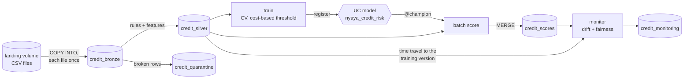

# Nyaya on Databricks

There are two ways to run the credit pipeline on Databricks:

| | Production job (Asset Bundle) | Quick start (one notebook) |
|---|---|---|
| Folder | `databricks/` | `notebooks/databricks_credit_pipeline.py` |
| What it is | A scheduled, 5-task job deployed from code with the Databricks CLI | One notebook you import and run |
| Ingestion | `COPY INTO` from a landing volume: each new file is loaded once | Reads one CSV |
| Model | Registered in **Unity Catalog** with `@champion` / `@challenger` aliases | Logged to MLflow |
| Scoring | Batch scoring with `@champion`, idempotent `MERGE` | Test-set scores |
| Monitoring | PSI drift against the champion's training data (Delta time travel) and fairness, stored over time | One fairness table |
| Use it for | Showing how it would run in a bank | A first look in 10 minutes |

Both run on **Databricks Free Edition** (serverless compute, Unity Catalog, no card needed).

---

## Production job

### What it does



| Task | Notebook | What happens | Fails the job when |
|---|---|---|---|
| `ingest` | `01_ingest.py` | `COPY INTO credit_bronze` from the landing volume, with load time and file name. Already-loaded files are skipped, so retries are safe. | The landing volume is empty on the first run |
| `silver` | `02_silver.py` | Same rules as the API: no missing values, numbers in range, categories from the codebook, label 0/1. Valid rows get features and a stable `applicant_id` (hash of the row); broken rows go to quarantine with reasons. Delta `CHECK` constraints guard the table. | More than 5% of the latest load is invalid (quality gate) |
| `train` | `03_train_register.py` | Skipped if no new rows arrived. Cross-validates logistic regression and gradient boosting, picks the lowest **expected cost** (a wrongly approved defaulter costs 5, a wrongly rejected good payer 1), registers the winner in Unity Catalog as `@challenger`, with its threshold and the silver version it learned from as tags. It becomes `@champion` only if it costs less than the current champion on the same applicants. | |
| `score` | `04_batch_score.py` | Loads `models:/…@champion`, scores the latest load: P(default), credit score 0-100, PASS/FAIL, `requires_human_review`. `MERGE` on (applicant, model version), so re-runs never duplicate. | |
| `monitor` | `05_monitor.py` | PSI per feature: latest load vs. the exact data the champion was trained on (silver `VERSION AS OF` the tagged version). Approval rates by age group, sex and foreign-worker status (four-fifths rule). Appends everything to `credit_monitoring`. | A feature drifts with PSI ≥ 0.25 (you get an email) |

The job runs daily at 06:00 Berlin time once you unpause it, emails you when it fails, and never
runs twice at the same time. The rules in `databricks/notebooks/common.py` are unit-tested against
the main package (`tests/test_databricks_common.py`), so Databricks and the API apply the same
data rules, the same score and the same PSI.

### Deploy it (about 15 minutes)

1. **Workspace.** Sign up for Databricks Free Edition at
   <https://www.databricks.com/learn/free-edition>. Note the workspace URL, like
   `https://dbc-1234abcd-5678.cloud.databricks.com`.
2. **CLI** (Windows Command Prompt):
   ```
   winget install Databricks.DatabricksCLI
   databricks auth login --host https://dbc-1234abcd-5678.cloud.databricks.com
   ```
   A browser window opens to sign in.
3. **Deploy** from the project folder:
   ```
   cd databricks
   databricks bundle validate
   databricks bundle deploy
   databricks bundle summary
   ```
   `deploy` creates the schema, the `landing` volume, the registered model and two jobs. In the
   default `dev` target their names get a `dev_<your name>_` prefix and the schedule stays paused, so
   experiments never touch production. `summary` shows the exact names and links.
4. **Upload the data:** in Databricks, **Catalog → workspace → (your schema) → landing → Upload to
   this volume** → `data/raw/german_credit.csv`. Or with the CLI (use the schema name from
   `summary`):
   ```
   databricks fs cp ..\data\raw\german_credit.csv dbfs:/Volumes/workspace/<schema>/landing/
   ```
5. **Run:**
   ```
   databricks bundle run credit_risk_pipeline
   ```
   The CLI prints a link to the run; open it to watch the five tasks.

To deploy a separate production copy (schema `nyaya`, schedule active):
`databricks bundle deploy -t prod`. Remove everything again with `databricks bundle destroy`.

### See it react to new data

The bundle also deploys a small demo job that drops a "new month" of applications into the landing
volume:

```
databricks bundle run simulate_new_month --params scenario=young_big_loans
databricks bundle run credit_risk_pipeline
```

| Scenario | What happens on the next pipeline run |
|---|---|
| `same` | New file loaded, new model version trained and compared with the champion, monitoring stable |
| `young_big_loans` | Under-25s with 30-80% larger loans: `housing` and `amount` drift, **monitor fails and emails you** |
| `bad_file` | 20% of rows have a negative amount: **silver's quality gate stops the job** before training |

### What to look at afterwards

- **Workflows → Jobs → nyaya-credit-risk-pipeline:** the task graph, run history and each task's output.
- **Catalog → (your schema):** the tables, each with a **History** tab (every write is a Delta
  version), and the model `nyaya_credit_risk` with its versions, aliases and tags.
- **Experiments → nyaya-credit-risk:** one parent run per training, with a child run per candidate.
- **SQL editor**, for example the drift and fairness history:
  ```sql
  SELECT checked_at, check, subject, group_name, round(value, 3) AS value, status
  FROM workspace.<schema>.credit_monitoring
  ORDER BY checked_at DESC, check, value DESC;
  ```

### Design decisions

- **Code, not clicks.** The job, schema, volume and model are defined in YAML and deployed with one
  command, so the setup is reviewed in Git and can be recreated in another workspace.
- **Idempotent steps.** `COPY INTO` loads each file once, silver is rebuilt from bronze, scores are
  merged. A failed run can simply be run again.
- **Traceable scores.** Each score row carries the model version; each model version carries the
  silver table version it was trained on. Any decision can be traced to the exact data behind it,
  which is what audits under the EU AI Act ask for.
- **No silent model changes.** Scoring uses the `@champion` alias. A new model has to beat it first.
  With about 200 test applicants the comparison is noisy, which is why the main project has a proper
  A/B test with a power analysis (`scripts/ab_test.py`).
- **Humans in the loop.** FAIL means "refer to an underwriter", never an automatic rejection (GDPR
  Article 22).
- **scikit-learn for training.** 1,000 rows fit in memory; Spark does the data engineering. With
  millions of rows, the same steps would train with Spark ML or on a larger single node.

### Result of the runs on Databricks Free Edition (17 October 2026)

Deployed with `databricks bundle deploy` (CLI v0.299, `DATABRICKS_BUNDLE_ENGINE=direct`) and run
from the command line.

| Run | What happened |
|---|---|
| 1. `german_credit.csv` (1,000 applicants) | All five tasks succeeded in 3 min 11 s. Model registered in Unity Catalog as version 1 and promoted to `@champion` (first model). |
| 2. `simulate_new_month`, scenario `young_big_loans` (300 applicants) | Ingest, silver, train and score succeeded. **Monitor raised a drift alert and failed the job by design:** `duration` PSI **1.83**, `amount` PSI **0.27** (alert threshold 0.25). The job owner was emailed. |

The first attempt at run 2 also found a real bug: `COPY INTO` with per-file schema inference read
`duration` as a different integer type in the new file, and Delta refused to merge the schemas
(`DELTA_FAILED_TO_MERGE_FIELDS`). Ingest now casts every column to a fixed type, and values that
cannot be cast become NULL and land in quarantine instead of failing the load.

**Tip for Windows:** if `winget` is missing, download the CLI zip from the
[releases page](https://github.com/databricks/cli/releases). If `bundle deploy` fails with
*"openpgp: key expired"* while downloading Terraform, use CLI v0.299+ and
`set DATABRICKS_BUNDLE_ENGINE=direct`, which deploys without Terraform. If the login was saved
under a profile name, `set DATABRICKS_CONFIG_PROFILE=<name>`.

---

## Quick start: one notebook

`notebooks/databricks_credit_pipeline.py` builds bronze, silver, quarantine and gold Delta tables,
trains two models with MLflow, writes scores and audits approval rates by age and sex.

1. In Databricks Free Edition: **Catalog → workspace → default → Create → Volume**, name it `raw`,
   open it and **Upload** `data/raw/german_credit.csv`.
2. **Workspace → your user folder → ⋮ → Import → File** → `notebooks/databricks_credit_pipeline.py`.
3. Open it, connect to **Serverless** and click **Run all**.

If you used another catalog, schema or volume, change the three widgets at the top of the notebook.

### Result of the run on Databricks Free Edition (October 2026)

| Step | Result |
|---|---|
| Silver | 1,000 rows passed the quality rules, 0 quarantined |
| MLflow | logistic regression CV AUC 0.764, expected cost 0.510; gradient boosting 0.782, 0.521 |
| Selected model | logistic regression (lowest cost) |
| Fairness | under-25 disparate impact 0.525 (fails four-fifths rule); female 0.932 (passes) |

These agree with the local pipeline: the age gap persists even though age is not a model input.
