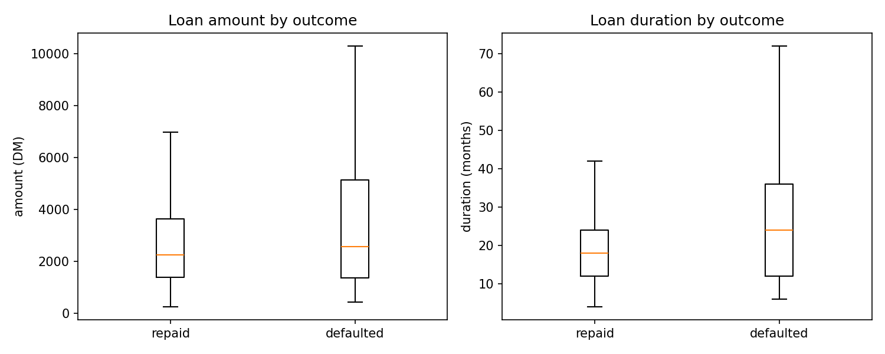
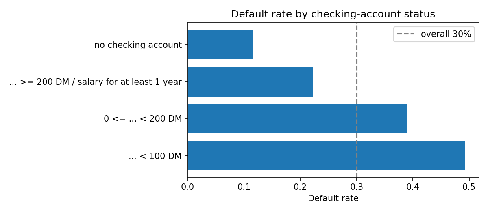

# Exploratory data analysis - German Credit

1,000 applicants, 30% defaulted, no missing values, 28 columns after feature engineering.

## Key findings

- Defaulters borrowed more (median 2,574 DM vs 2,244 DM) for longer (median 24 vs 18 months).
- Duration has the strongest linear link with default (r = 0.21); age is weakly negative (r = -0.09).
- Checking-account status is a strong separator: default rates range from 12% to 49%.
- Applicants under 25 default more often (41% vs 28%), so age-related disparities must be audited, not assumed away.

## Default rate by category (groups with at least 30 applicants)

### status

| value | n | default rate |
|---|---|---|
| ... < 100 DM | 274 | 49% |
| 0 <= ... < 200 DM | 269 | 39% |
| ... >= 200 DM / salary for at least 1 year | 63 | 22% |
| no checking account | 394 | 12% |

### credit_history

| value | n | default rate |
|---|---|---|
| no credits taken/all credits paid back duly | 40 | 62% |
| all credits at this bank paid back duly | 49 | 57% |
| existing credits paid back duly till now | 530 | 32% |
| delay in paying off in the past | 88 | 32% |
| critical account/other credits existing | 293 | 17% |

### savings

| value | n | default rate |
|---|---|---|
| ... < 100 DM | 603 | 36% |
| 100 <= ... < 500 DM | 103 | 33% |
| unknown/no savings account | 183 | 17% |
| 500 <= ... < 1000 DM | 63 | 17% |
| ... >= 1000 DM | 48 | 12% |

### purpose

| value | n | default rate |
|---|---|---|
| retraining | 50 | 44% |
| car (new) | 234 | 38% |
| others | 97 | 35% |
| radio/television | 181 | 32% |
| domestic appliances | 280 | 22% |
| car (used) | 103 | 17% |

### housing

| value | n | default rate |
|---|---|---|
| for free | 108 | 41% |
| rent | 179 | 39% |
| own | 713 | 26% |

## Data caveat

Category labels come from the decoded CSV mirror. Groemping (2019) showed that the original Statlog codebook mislabels several categories (e.g. credit history and loan purpose), which explains counter-intuitive patterns such as 'critical account' lowering risk. The numeric values are the real survey data; treat category names as approximate.